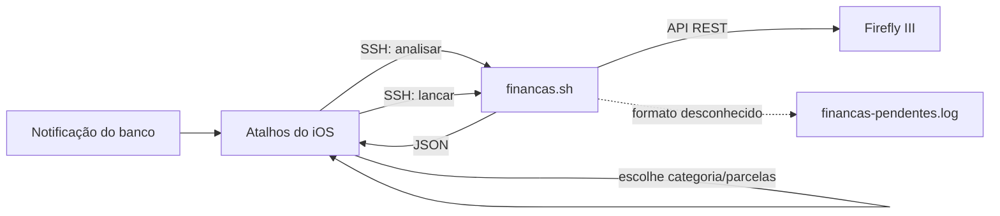

# financas.sh

Lança automaticamente no [Firefly III](https://www.firefly-iii.org/) as despesas que chegam como notificação do banco no iPhone.

A notificação dispara um atalho no app **Atalhos** do iOS, que fala com o `financas.sh` num servidor de casa por SSH, em duas etapas:

1. **analisar**: o script valida a notificação e responde ao Atalhos o que fazer (pedir a categoria, pedir as parcelas, ou nada);
2. **lancar**: com a categoria e as parcelas escolhidas no celular, o script cria a transação pela API do Firefly.



Mensagens que o script ainda não sabe interpretar não são perdidas: ficam salvas em `financas-pendentes.log` para virarem novas regras.

## Bancos e mensagens suportados

| Banco | Mensagem | O que acontece |
|---|---|---|
| Inter | `Olá <nome>, você acaba de comprar no débito no(a) <local> o valor de R$ <valor>` | Pede a categoria e lança uma despesa da conta Inter |
| Inter | `Você fez um Pix no valor de R$ <valor> para <destinatário>` | Se o valor for **igual** ao de uma transação recorrente ativa no Firefly, **não lança** (o Firefly já lança a recorrente). Senão, pede a categoria e lança. |
| C6 | `Sua compra no cartão final <final> no valor de R$ <valor>, dia <data> às <hora>, em <local>, foi aprovada.` | Pede a categoria e as parcelas; lança no cartão C6 (sempre crédito) |

Em cada lançamento:
- **valor**: `R$ 1.245,90` vira `1245.90`;
- **descrição e conta de destino**: o local ou o destinatário, então cada loja ou pessoa ganha seu próprio histórico nos relatórios;
- **notas**: o texto original da notificação;
- **tags**: `notificacao`, o nome do app e, no C6, `final-<final do cartão>`;
- **categoria**: a escolhida no Atalhos (opcional).

### Parcelas (só C6)

| Escolha no Atalhos | Resultado |
|---|---|
| `1` | Uma despesa |
| `2` a `18` | Uma despesa por mês, `<local> (1/N)` … `<local> (N/N)`, com a tag `parcelado`. O valor da notificação é tratado como **total**; a última parcela absorve os centavos do arredondamento. A partir da 2ª parcela, a data cai no mesmo dia dos meses seguintes (ou no último dia, em meses mais curtos). |
| `Recorrente` | Lança a compra deste mês e cria uma **transação recorrente mensal sem fim** no Firefly, a partir do mês que vem (ex.: assinaturas no cartão) |

Reenviar a mesma notificação não duplica nada: o script responde "Já lançado anteriormente".

### Categoria Contas (contas de consumo)

Para contas que se repetem mas mudam de valor (luz, água, internet…), use a categoria **Contas** ou **Contas da casa**. O Atalhos pede então o **nome da conta**:

- se a conta já existe no Firefly (em *Contas/Assinaturas*), a transação é vinculada a ela;
- se não existe, o script **cria a conta** (mensal, com faixa de valor de ±30% do valor pago, que você pode ajustar depois no Firefly) e vincula a transação.

Assim o Firefly mostra, para cada conta, o que já foi pago no mês e o que ainda falta. Contas parceladas ou `Recorrente` não são vinculadas.

## Requisitos

- Um servidor Linux acessível por SSH a partir do iPhone (mini PC, Raspberry Pi, VPS…)
- `curl` e `jq`
- Firefly III com acesso à API

```sh
sudo apt install curl jq
```

## Instalação

```sh
sudo mkdir -p /scripts/financas
sudo chown -R "$USER" /scripts/financas
cd /scripts/financas

# copie financas.sh e .env.example para esta pasta
chmod +x financas.sh
cp .env.example .env
chmod 600 .env
```

Qualquer pasta serve. O script procura o `.env` e grava os logs **na própria pasta onde está**. O usuário usado no SSH precisa ter permissão de leitura e escrita nela.

## Configuração

### 1. Preparar o Firefly III

1. **Crie as contas de origem** em *Contas → Contas de ativo*, com os nomes exatos `Inter` e `C6 Cartão`. Se quiser outros nomes, defina as variáveis no `.env`. O cartão pode ser uma conta de ativo com o papel *Cartão de crédito*.
2. **Gere um token:** em *Opções → Perfil → OAuth → Personal Access Tokens*, clique em *Criar novo token*. O token só é exibido uma vez; copie o valor inteiro.
3. **Configure o cron do Firefly.** Transações recorrentes só são lançadas automaticamente se o cron do Firefly estiver rodando (veja *Cron jobs* na documentação do Firefly). Sem ele, a checagem de Pix e as compras `Recorrente` não fazem sentido.
4. **(Opcional) Crie regras de categorização** em *Automação → Regras*. Exemplo: "se a descrição contém `PADARIA`, defina a categoria `Alimentação`". O script envia `apply_rules: true`, então as regras rodam em todo lançamento.

O Firefly não vem com categorias prontas. Ele cria a categoria automaticamente na primeira vez que recebe um nome novo.

### 2. Preencher o `.env`

```sh
# Obrigatórios
FIREFLY_URL="http://localhost:8080"
FIREFLY_TOKEN="cole_aqui_o_personal_access_token"

# Opcionais (os valores abaixo são os padrões)
FIREFLY_CONTA_INTER="Inter"
FIREFLY_CONTA_C6="C6 Cartão"
```

| Variável | Obrigatória | Descrição |
|---|---|---|
| `FIREFLY_URL` | sim | Endereço do Firefly visto do servidor, sem `/` no final |
| `FIREFLY_TOKEN` | sim | Personal Access Token do Firefly |
| `FIREFLY_CONTA_INTER` | não | Conta de ativo do Inter (padrão: `Inter`) |
| `FIREFLY_CONTA_C6` | não | Conta do cartão C6 (padrão: `C6 Cartão`) |
| `FINANCAS_LOG` | não | Log de execução (padrão: `financas.log` na pasta do script) |
| `FINANCAS_PENDENTES` | não | Mensagens não reconhecidas (padrão: `financas-pendentes.log` na pasta do script) |
| `FINANCAS_ENV` | não | Caminho de um `.env` alternativo (definido no ambiente, não no `.env`) |

O script procura a configuração nesta ordem e usa o primeiro arquivo que encontrar: `$FINANCAS_ENV`, depois `.env` na pasta do script, depois `~/.financas.env`.

> O `.env` é carregado como shell (`. .env`): não use espaços em volta do `=` e mantenha os valores entre aspas.

### 3. Categorias

As categorias oferecidas no celular ficam na variável `CATEGORIAS`, no início do `financas.sh`. Edite ali para mudar a lista.

## Comandos e formato da entrada

A entrada é **um texto com um item por linha**, enviado pelo stdin (é o que o Atalhos faz com o campo *Entrada*).

### `financas.sh analisar`

```
C6
Sua compra no cartão final 1234 no valor de R$ 114,96, dia 08/11/2026 às 18:42, em LOJA X, foi aprovada.
2026-11-08T18:42:00-03:00
```

Responde um JSON para o Atalhos:

```json
{
  "acao": "escolher",
  "mensagem": "Compra de R$ 114,96 em LOJA X",
  "pedir_parcelas": "sim",
  "categorias": ["Mercado", "Alimentação", "..."],
  "parcelas": ["1", "2", "...", "18", "Recorrente"],
  "contas": ["CEMIG", "Copasa", "+ Nova conta"]
}
```

`contas` traz as contas ativas do Firefly mais a opção `+ Nova conta`.

| `acao` | Significado |
|---|---|
| `escolher` | Notificação válida: escolha a categoria (e as parcelas, se `pedir_parcelas` for `sim`) e chame `lancar` |
| `recorrente` | Pix com o mesmo valor de uma recorrência ativa: nada a lançar. A `mensagem` diz qual. |
| `ignorar` | Notificação não reconhecida; foi salva em `financas-pendentes.log` |

### `financas.sh lancar`

As mesmas linhas, mais a categoria, as parcelas e, só para a categoria Contas, o nome da conta:

```
C6
Sua compra no cartão final 1234 no valor de R$ 114,96, dia 08/11/2026 às 18:42, em LOJA X, foi aprovada.
2026-11-08T18:42:00-03:00
Compras
3
```

| Linha | Conteúdo |
|---|---|
| 1 | Nome do app |
| 2 … | Corpo da notificação (pode ocupar várias linhas) |
| depois do corpo | Data em ISO 8601 |
| seguinte | Categoria (pode ficar vazia) |
| seguinte | Parcelas: `1` a `18` ou `Recorrente` (vazia = `1`; ignorada fora do C6) |
| última | Nome da conta (bill), só com a categoria Contas; criada se não existir |

Responde uma linha de texto para exibir no celular, por exemplo `Lançado: R$ 114,96 em LOJA X, 3x de R$ 38,32`.

### `financas.sh --categorias`

Lista as categorias, uma por linha.

## Testando no servidor

Simulação, sem enviar nada ao Firefly (mostra o JSON que seria enviado):

```sh
printf 'C6\nSua compra no cartão final 1234 no valor de R$ 114,96, dia 08/11/2026 às 18:42, em LOJA X, foi aprovada.\n2026-11-08T18:42:00-03:00\nCompras\n3\n' \
  | FIREFLY_DRY_RUN=1 /scripts/financas/financas.sh lancar
```

Em `FIREFLY_DRY_RUN=1`, o `analisar` não consulta as recorrências do Firefly. Se o resultado estiver correto, rode sem a variável para lançar de verdade.

## Configurando o Atalhos do iOS

### Antes de começar: acesso SSH

A ação **Executar Script por SSH** precisa de host, porta, usuário e autenticação. Prefira **chave SSH**:

1. Em qualquer ação *Executar Script por SSH*, em *Autenticação*, escolha **Chave SSH** e toque em *Chave SSH* para gerar uma.
2. Toque em *Compartilhar Chave Pública* e adicione o conteúdo em `~/.ssh/authorized_keys` no servidor.

Se o atalho for rodar fora da rede de casa (por DNS dinâmico, por exemplo), a porta SSH fica exposta na internet. Nesse caso use apenas chave e desative o login por senha no servidor (`PasswordAuthentication no` em `/etc/ssh/sshd_config`).

### Montando o atalho

O atalho recebe da automação os dados da notificação: **App**, **Corpo** e **Data** (em ISO 8601; se precisar converter, use **Formatar Data** com o formato *ISO 8601*).

**1. Montar a notificação**
- Ação **Texto**, com **cada variável numa linha própria** (Enter entre elas):
  ```
  [App]
  [Corpo]
  [Data]
  ```
- Renomeie a saída para `Notificação`.

**2. Analisar**
- Ação **Executar Script por SSH**
- Script: `/scripts/financas/financas.sh analisar`
- Entrada: `Notificação`

**3. Ler a resposta**
- Ação **Obter Dicionário da Entrada**, usando a saída do passo 2. Renomeie para `Resposta`.

**4. Decidir**
- Ação **Se**: `Resposta` › valor de `acao` · **é** · `escolher`

  **Dentro do Se:**

  4.1. **Escolher da Lista**: `Resposta` › valor de `categorias`. Prompt: `Categoria?`. Renomeie para `Categoria`.

  4.2. **Se**: `Resposta` › valor de `pedir_parcelas` · **é** · `sim`
  - **Escolher da Lista**: `Resposta` › valor de `parcelas`. Prompt: `Parcelas?`
  - **Definir Variável** `Parcelas` como o item escolhido
  - **Senão**: **Texto** `1` → **Definir Variável** `Parcelas`
  - **Fim do Se**

  4.3. **Se**: `Categoria` · **é** · `Contas` **ou** `Contas da casa` (condição *Qualquer*)
  - **Escolher da Lista**: `Resposta` › valor de `contas`. Prompt: `Conta?`
  - **Se** o item escolhido **é** `+ Nova conta`: **Pedir Entrada** (Texto, `Nome da conta?`) → **Definir Variável** `Conta`
  - **Senão**: **Definir Variável** `Conta` com o item escolhido
  - **Fim do Se**
  - **Senão** (outras categorias): **Texto** vazio → **Definir Variável** `Conta`
  - **Fim do Se**

  4.4. **Texto**, um item por linha:
  ```
  [Notificação]
  [Categoria]
  [Parcelas]
  [Conta]
  ```

  4.5. **Executar Script por SSH**
  - Script: `/scripts/financas/financas.sh lancar`
  - Entrada: o texto do passo 4.4

  4.6. **Mostrar Notificação**: saída do passo 4.5

  **Senão:**

  4.7. *(opcional)* **Se** `Resposta` › valor de `acao` **é** `recorrente` → **Mostrar Notificação** com `Resposta` › valor de `mensagem`. Para `ignorar`, não faça nada.

  **Fim do Se**

Use sempre o **caminho absoluto** do script e mande o texto pelo campo **Entrada**, nunca dentro do campo *Script*: caracteres como `$` e aspas seriam interpretados pelo shell.

Como a categoria é escolhida na tela, a automação espera um toque a cada compra. Para notificações `recorrente` ou `ignorar`, nada é perguntado.

## Logs

Os arquivos ficam na pasta do script.

**`financas.log`**: uma linha por evento.

| Linha | Significado |
|---|---|
| `OK: R$ 30,00 -> Fulano (...)` | Lançado no Firefly |
| `DUPLICADA (ignorada): ...` | Já existia; nada foi duplicado |
| `RECORRENTE: Pix ... bate com 'Aluguel'` | Pix coberto por uma recorrência; não lançado |
| `RECORRÊNCIA criada: ...` | Compra `Recorrente` criou a recorrência mensal |
| `CONTA criada: ...` | Categoria Contas com um nome novo criou a conta (bill) |
| `PENDENTE (...)` | Mensagem não reconhecida, salva em `financas-pendentes.log` |
| `AVISO: ...` | Algo foi ignorado (ex.: parcelas em compra no débito) |
| `ERRO: HTTP 401` | Token inválido ou expirado |
| `ERRO: HTTP 000 ...` | URL errada ou Firefly fora do ar |

**`financas-pendentes.log`**: o texto completo de cada mensagem não reconhecida, com o motivo. É a matéria-prima para suportar novos bancos e mensagens.

```sh
tail -f /scripts/financas/financas.log
```

## Solução de problemas

**`formato inválido: esperava App, Corpo e Data em linhas separadas`**
O Atalhos juntou os itens com espaço em vez de quebra de linha, ou a data não está em ISO 8601. No passo 1, cada variável precisa estar numa linha própria.

**`defina FIREFLY_URL no .env`**
O script não encontrou o `.env`. Verifique se ele está na mesma pasta do `financas.sh` e se o usuário do SSH consegue lê-lo (`ls -l .env`; o dono deve ser esse usuário).

**`Permission denied` ao gravar log**
O usuário do SSH não tem permissão de escrita na pasta: `sudo chown -R <usuario> /scripts/financas`.

**O Firefly recusa com erro de conta**
A conta de origem (`Inter` ou `C6 Cartão`) não existe com esse nome exato. Crie a conta ou ajuste o nome no `.env`.

**Um Pix foi ignorado como recorrente sem ser**
A checagem compara só o **valor**. Um Pix com o mesmo valor de uma recorrência ativa é tratado como pagamento dela.

## Adicionando um novo banco

1. Deixe as notificações do banco chegarem e copie exemplos reais de `financas-pendentes.log`.
2. Crie uma função `parse_<banco>` no `financas.sh` seguindo o modelo de `parse_inter` e `parse_c6`. Ela deve preencher `MSG` (`compra` ou `pix`), `VALOR`, `ORIGEM`, `DESTINO` e `PERMITE_PARCELAS` (`sim` ou `nao`), retornar `0` quando reconhecer a mensagem e `1` quando não reconhecer.
3. Registre a função no `case` que escolhe o parser pelo nome do app.
4. Teste com `FIREFLY_DRY_RUN=1` usando os exemplos do log.

## Segurança

- O `.env` contém um token com acesso total ao Firefly: mantenha `chmod 600` e **nunca** faça commit dele (já está no `.gitignore`).
- Os logs contêm dados financeiros pessoais e também ficam fora do repositório.
- Use autenticação por chave no SSH.
