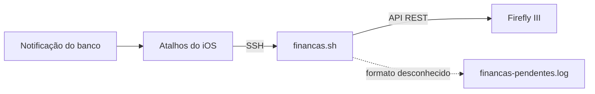

# financas.sh

Lança automaticamente no [Firefly III](https://www.firefly-iii.org/) as despesas que chegam como notificação do banco no iPhone.

O fluxo é: a notificação do banco dispara um atalho no app **Atalhos** do iOS, o atalho envia o texto por SSH para um servidor em casa, e o `financas.sh` interpreta a mensagem e cria a transação pela API do Firefly.



Mensagens que o script ainda não sabe interpretar não são perdidas: ficam salvas em `financas-pendentes.log` para virarem novas regras.

## Bancos e mensagens suportados

| Banco | Mensagem | Resultado no Firefly |
|---|---|---|
| Inter | `Olá <nome>, você acaba de comprar no débito no(a) <local> o valor de R$ <valor>` | Despesa da conta Inter para `<local>` |
| Inter | `Você fez um Pix no valor de R$ <valor> para <destinatário>` | Despesa da conta Inter para `<destinatário>` |

Em cada lançamento:
- **valor**: `R$ 1.245,90` vira `1245.90`;
- **descrição e conta de destino**: o local ou o destinatário, então cada loja ou pessoa ganha seu próprio histórico nos relatórios;
- **notas**: o texto original da notificação;
- **tags**: `notificacao` e o nome do app;
- **categoria**: a que vier do Atalhos (opcional).

## Requisitos

- Um servidor Linux acessível por SSH a partir do iPhone (mini PC, Raspberry Pi, VPS…)
- `curl` e `jq`
- Firefly III com acesso à API

```sh
sudo apt install curl jq
```

## Instalação

```sh
sudo mkdir -p /scripts/financas
sudo chown -R "$USER" /scripts/financas
cd /scripts/financas

# copie financas.sh e .env.example para esta pasta
chmod +x financas.sh
cp .env.example .env
chmod 600 .env
```

Qualquer pasta serve. O script procura o `.env` e grava os logs **na própria pasta onde está**. O usuário usado no SSH precisa ter permissão de leitura e escrita nela.

## Configuração

### 1. Preparar o Firefly III

1. **Crie a conta do banco:** em *Contas → Contas de ativo*, crie uma conta chamada exatamente `Inter`, ou use outro nome e defina `FIREFLY_CONTA_INTER`.
2. **Gere um token:** em *Opções → Perfil → OAuth → Personal Access Tokens*, clique em *Criar novo token*. O token só é exibido uma vez; copie o valor inteiro.
3. **(Opcional) Crie regras de categorização:** em *Automação → Regras*. Exemplo: "se a descrição contém `PADARIA`, defina a categoria `Alimentação`". O script envia `apply_rules: true`, então as regras rodam em todo lançamento.

O Firefly não vem com categorias prontas. Ele cria a categoria automaticamente na primeira vez que recebe um nome novo.

### 2. Preencher o `.env`

```sh
# Obrigatórios
FIREFLY_URL="http://localhost:8080"
FIREFLY_TOKEN="cole_aqui_o_personal_access_token"

# Opcionais (os valores abaixo são os padrões)
FIREFLY_CONTA_INTER="Inter"
# FINANCAS_LOG="/scripts/financas/financas.log"
# FINANCAS_PENDENTES="/scripts/financas/financas-pendentes.log"
```

| Variável | Obrigatória | Descrição |
|---|---|---|
| `FIREFLY_URL` | sim | Endereço do Firefly visto do servidor, sem `/` no final |
| `FIREFLY_TOKEN` | sim | Personal Access Token do Firefly |
| `FIREFLY_CONTA_INTER` | não | Nome da conta de ativo do Inter (padrão: `Inter`) |
| `FINANCAS_LOG` | não | Log de execução (padrão: `financas.log` na pasta do script) |
| `FINANCAS_PENDENTES` | não | Mensagens não reconhecidas (padrão: `financas-pendentes.log` na pasta do script) |
| `FINANCAS_ENV` | não | Caminho de um `.env` alternativo (definido no ambiente, não no `.env`) |

O script procura a configuração nesta ordem e usa o primeiro arquivo que encontrar: `$FINANCAS_ENV`, depois `.env` na pasta do script, depois `~/.financas.env`.

> O `.env` é carregado como shell (`. .env`): não use espaços em volta do `=` e mantenha os valores entre aspas.

### 3. Lista de categorias (opcional)

O atalho busca as categorias no próprio script, então a lista fica num lugar só. Para editar, altere a variável `CATEGORIAS` no início do `financas.sh`:

```sh
./financas.sh --categorias
```

## Formato da entrada

O script recebe **um texto, com um item por linha**, pelo stdin (é assim que o Atalhos envia) ou como parâmetro único:

```
Inter
Você fez um Pix no valor de R$ 30,00 para Fulano de Tal
2026-11-08T12:31:10-03:00
Lazer
```

| Linha | Conteúdo |
|---|---|
| 1 | Nome do app |
| 2 … n-2 | Corpo da notificação (pode ocupar várias linhas) |
| n-1 | Data em ISO 8601 |
| n | Categoria (opcional; se omitida, a data passa a ser a última linha) |

## Testando no servidor

Simulação, sem enviar nada ao Firefly (mostra o JSON que seria enviado):

```sh
printf 'Inter\nVocê fez um Pix no valor de R$ 1,00 para Teste\n2026-11-08T12:00:00-03:00\nOutros\n' \
  | FIREFLY_DRY_RUN=1 /scripts/financas/financas.sh
```

Se o JSON estiver correto, rode a mesma linha sem `FIREFLY_DRY_RUN=1` para lançar de verdade.

## Configurando o Atalhos do iOS

### Antes de começar: acesso SSH

A ação **Executar Script por SSH** do Atalhos precisa de host, porta, usuário e autenticação. Prefira **chave SSH**:

1. Em qualquer ação *Executar Script por SSH*, em *Autenticação*, escolha **Chave SSH** e toque em *Chave SSH* para gerar uma.
2. Toque em *Compartilhar Chave Pública* e adicione o conteúdo em `~/.ssh/authorized_keys` no servidor.

Se o atalho for rodar fora da rede de casa (por DNS dinâmico, por exemplo), a porta SSH fica exposta na internet. Nesse caso use apenas chave e desative o login por senha no servidor (`PasswordAuthentication no` em `/etc/ssh/sshd_config`).

### Montando o atalho

O atalho recebe da automação os dados da notificação (**App**, **Corpo** e **Data**) e executa estas ações, em ordem:

**1. Buscar as categorias no servidor** *(opcional)*
- Ação: **Executar Script por SSH**
- Script: `/scripts/financas/financas.sh --categorias`
- Entrada: *(vazia)*

**2. Transformar a saída em lista** *(opcional)*
- Ação: **Dividir Texto**
- Texto: *Saída do Shell* do passo 1
- Separador: **Novas Linhas**

**3. Escolher a categoria** *(opcional)*
- Ação: **Escolher da Lista**
- Lista: *Texto Dividido* do passo 2
- Prompt: `Categoria?`
- O item escolhido fica na variável **Item Escolhido**.

**4. Montar o texto de envio**
- Ação: **Texto**
- Coloque **cada variável numa linha própria**, apertando Enter entre elas:
  ```
  [App]
  [Corpo]
  [Data]
  [Item Escolhido]
  ```
- A data deve estar em ISO 8601. Se precisar converter, use **Formatar Data** com o formato *ISO 8601*.
- Se você pulou os passos 1 a 3, deixe só as três primeiras linhas.

**5. Enviar para o servidor**
- Ação: **Executar Script por SSH**
- Script: `/scripts/financas/financas.sh`
- Entrada: *Texto* do passo 4

Use sempre o **caminho absoluto** do script. O texto vai pelo campo **Entrada**, que chega ao script como stdin. Não coloque o texto dentro do campo *Script*: caracteres como `$` e aspas seriam interpretados pelo shell.

### Categoria manual ou automática?

| Opção | Como | Quando usar |
|---|---|---|
| **Manual** | Passos 1 a 3 | Quer escolher a categoria a cada compra. A automação vai esperar um toque na tela. |
| **Automática** | Pule os passos 1 a 3 e crie Regras no Firefly | Quer que tudo rode sem interação. As regras classificam pela descrição. |

## Logs

Os dois arquivos ficam na pasta do script.

**`financas.log`**: uma linha por execução.

| Linha | Significado |
|---|---|
| `OK: withdrawal R$ 30.00 -> Fulano` | Lançado no Firefly |
| `IGNORADO (422): ...` | Firefly recusou: transação duplicada ou dado inválido (detalhe na mensagem) |
| `PENDENTE (...)` | Mensagem não reconhecida, salva em `financas-pendentes.log` |
| `ERRO: HTTP 401` | Token inválido ou expirado |
| `ERRO: curl falhou ...` | URL errada ou Firefly fora do ar |

**`financas-pendentes.log`**: o texto completo de cada mensagem não reconhecida, com o motivo. É a matéria-prima para suportar novos bancos.

```sh
tail -f /scripts/financas/financas.log
```

## Solução de problemas

**`PENDENTE (esperava ao menos 3 linhas, recebi 1)`**
O Atalhos juntou os itens com espaço em vez de quebra de linha. No passo 4, cada variável precisa estar numa linha própria. Se usar *Combinar Texto*, escolha o separador **Nova Linha**.

**`defina FIREFLY_URL no .env`**
O script não encontrou o `.env`. Verifique se ele está na mesma pasta do `financas.sh` e se o usuário do SSH consegue lê-lo (`ls -l .env`; o dono deve ser esse usuário).

**`Permission denied` ao gravar log**
O usuário do SSH não tem permissão de escrita na pasta: `sudo chown -R <usuario> /scripts/financas`.

**Lançamento duplicado não aparece**
É intencional. O script envia `error_if_duplicate_hash: true` e o Firefly recusa uma transação idêntica a outra já existente, evitando duplicidade se a notificação chegar duas vezes.

## Adicionando um novo banco

1. Deixe as notificações do banco chegarem e copie exemplos reais de `financas-pendentes.log`.
2. Crie uma função `parse_<banco>` no script seguindo o modelo de `parse_inter`. Ela deve preencher `TIPO` (`withdrawal` ou `deposit`), `VALOR`, `ORIGEM` e `DESTINO`, retornar `0` quando reconhecer a mensagem e `1` quando não reconhecer.
3. Registre a função no `case` que escolhe o parser pelo nome do app.
4. Teste com `FIREFLY_DRY_RUN=1` usando os exemplos do log.

Para receitas (`deposit`), a origem é quem pagou e o destino é a sua conta de ativo.

## Segurança

- O `.env` contém um token com acesso total ao Firefly: mantenha `chmod 600` e **nunca** faça commit dele (já está no `.gitignore`).
- Os logs contêm dados financeiros pessoais e também ficam fora do repositório.
- Use autenticação por chave no SSH.
